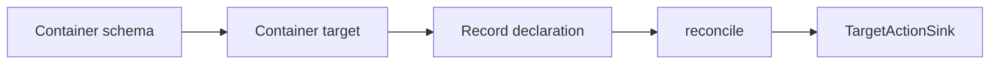

# Vector and Key-Value Targets

## Summary

These targets maintain keyed records in a vector-search container: a LanceDB table, zvec or Qdrant collection, Turbopuffer namespace, or Valkey search index. Container schemas determine how vectors and searchable fields are represented; record handlers reconcile changed and missing declarations. [python/cocoindex/connectors/lancedb/_target.py:1410-1418] [python/cocoindex/connectors/qdrant/_target.py:288-315] [python/cocoindex/connectors/turbopuffer/_target.py:316-345]

## Containers and records

| Connector | Container | Python record and key |
|---|---|---|
| LanceDB | Table | Row keyed by one or more primary-key columns. [python/cocoindex/connectors/lancedb/_target.py:223-228] [python/cocoindex/connectors/lancedb/_target.py:1292-1303] |
| zvec | Collection in a local directory | Row converted to a document; one scalar primary key becomes its string ID. [python/cocoindex/connectors/zvec/_target.py:444-475] [python/cocoindex/connectors/zvec/_target.py:894-905] |
| Qdrant | Collection | `PointStruct` keyed by an unsigned 64-bit integer or UUID. [python/cocoindex/connectors/qdrant/_target.py:550-564] |
| Turbopuffer | Namespace | `Row` keyed by a string or integer ID, with vectors and attributes. [python/cocoindex/connectors/turbopuffer/_target.py:176-190] [python/cocoindex/connectors/turbopuffer/_target.py:505-514] |
| Valkey | Search index over hash keys | `Document` keyed by a string ID, with one vector and optional payload. [python/cocoindex/connectors/valkey/_target.py:179-191] [python/cocoindex/connectors/valkey/_target.py:634-643] |

A container target supplies the child provider used to declare records. For example, the Qdrant pipeline mounts a collection using the embedder’s vector schema: [examples/text_embedding_qdrant/main.py:91-106]

```python
    target_collection = await qdrant.mount_collection_target(
        QDRANT_DB,
        collection_name=QDRANT_COLLECTION,
        schema=await qdrant.CollectionSchema.create(
            vectors=qdrant.QdrantVectorDef(schema=EMBEDDER)
        ),
    )
```

[examples/text_embedding_qdrant/main.py:93-99]

## Vectors and indexes

| Connector | Vector and index model |
|---|---|
| LanceDB | Vector and full-text indexes are separate table attachments; vector indexes support IVF-PQ and HNSW-PQ. [python/cocoindex/connectors/lancedb/_target.py:669-675] [python/cocoindex/connectors/lancedb/_target.py:1322-1338] |
| zvec | Dense and sparse vector fields and FTS fields are configured in the collection schema. [python/cocoindex/connectors/zvec/_target.py:231-251] |
| Qdrant | A collection has an unnamed dense vector or named dense and sparse vectors; dense definitions can be multivectors. Sparse vectors must be named. [python/cocoindex/connectors/qdrant/_target.py:53-82] [python/cocoindex/connectors/qdrant/_target.py:181-197] |
| Turbopuffer | A namespace has one unnamed or several named vectors, sharing one distance metric. [python/cocoindex/connectors/turbopuffer/_target.py:101-105] [python/cocoindex/connectors/turbopuffer/_target.py:127-141] |
| Valkey | The index has one vector field using HNSW or flat, plus optional text, tag, and numeric payload fields. [python/cocoindex/connectors/valkey/_target.py:66-98] |

## Reconciliation and SDKs



Record handlers compare desired content with previous fingerprints, upsert changes, and remove missing declarations. Container ownership is configurable through `managed_by`; system-managed schema replacement can invalidate child records. See [Target Reconciliation](target-reconciliation.md) for the shared mechanism. [python/cocoindex/connectors/valkey/_target.py:325-371] [python/cocoindex/connectors/valkey/_target.py:649-665] [python/cocoindex/connectors/valkey/_target.py:579-582]

Python provides all five connectors. The Rust SDK exposes feature-gated LanceDB, Qdrant, Turbopuffer, and Valkey modules; their declaration APIs use Rust values and `Ctx`. [rust/sdk/cocoindex/src/connectors/mod.rs:15-16] [rust/sdk/cocoindex/src/connectors/mod.rs:23-32] [rust/sdk/cocoindex/src/connectors/lancedb.rs:447-453]

For schema evolution, indexes, and writes in detail, read [LanceDB and zvec Targets](source-and-target-connectors-lancedb-and-zvec.md) or [Qdrant, Turbopuffer and Valkey Targets](source-and-target-connectors-qdrant-turbopuffer-and-valkey.md).

## Terms

- **Container target**: A declared table, collection, namespace, or index that provides child record targets. [python/cocoindex/connectors/turbopuffer/_target.py:520-530]
- **Vector schema provider**: A source of vector metadata used to resolve a connector’s vector definition. [python/cocoindex/connectors/valkey/_target.py:66-78]