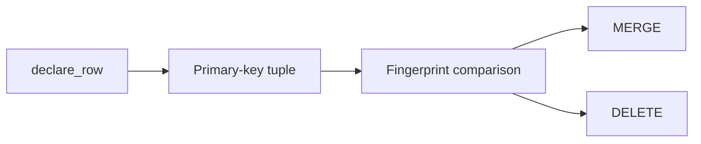

# Warehouse Connectors

## Summary

BigQuery and Snowflake targets declare tables and keyed rows, then reconcile schema changes and row mutations. Both use per-row `MERGE` statements for upserts and a keyed `DELETE` for removals; their connection, parameter, and transaction handling differ. [python/cocoindex/connectors/bigquery/_target.py:497-534] [python/cocoindex/connectors/snowflake/_target.py:394-432]

## Declare a table

Both `TableSchema.from_class` methods accept a dataclass, `NamedTuple`, or Pydantic model and a list of primary-key columns. The key columns must be present in the schema; `declare_row` uses their values as the target-state key. [python/cocoindex/connectors/bigquery/_target.py:108-154] [python/cocoindex/connectors/snowflake/_target.py:800-803]

The BigQuery example provides a `ConnectionConfig` in the environment and mounts the table before processing orders: [examples/bigquery_target/main.py:80-90] [examples/bigquery_target/main.py:112-129]

```python
    table = await bigquery.mount_table_target(
        BIGQUERY,
        table_name=TABLE_NAME,
        table_schema=await bigquery.TableSchema.from_class(
            BigQueryOrder,
            primary_key=["order_id"],
        ),
        project=PROJECT,
        dataset=DATASET,
    )
```

[examples/bigquery_target/main.py:114-123]

| | BigQuery | Snowflake |
|---|---|---|
| Connection config | Project, optional credentials path and location | Account, user, password, optional warehouse and role |
| Table location | Project, dataset, table | Database, schema, table |
| Created primary-key DDL | `PRIMARY KEY ... NOT ENFORCED` | `PRIMARY KEY ...` |

The connectors validate identifiers before constructing qualified names. System management is the default for both targets. [python/cocoindex/connectors/bigquery/_target.py:59-64] [python/cocoindex/connectors/snowflake/_target.py:58-65] [python/cocoindex/connectors/bigquery/_target.py:658-683] [python/cocoindex/connectors/snowflake/_target.py:558-584] [python/cocoindex/connectors/bigquery/_target.py:915-934] [python/cocoindex/connectors/snowflake/_target.py:819-839]

## Schema reconciliation

The table tracking record separates the primary-key signature from non-key column types and nullability. A table replacement invalidates children destructively; other non-insert column changes are marked lossy so rows can be reconciled again. [python/cocoindex/connectors/bigquery/_target.py:611-629] [python/cocoindex/connectors/bigquery/_target.py:843-860] [python/cocoindex/connectors/snowflake/_target.py:747-764]

Both implementations add or drop non-key columns with `ALTER TABLE`; replacing a column drops and adds it, which can discard its values. An `upsert` table action may find an existing table, so it also applies column transitions. See [State Diffs and Schema Evolution](state-diffs-and-schema-evolution.md) for the shared transition model. [python/cocoindex/connectors/bigquery/_target.py:687-742] [python/cocoindex/connectors/snowflake/_target.py:690-707]

## Encoding and row writes



Unchanged row fingerprints skip writes. Each changed row gets its own `MERGE`, matching all primary-key columns and updating non-key columns; deletions are combined into one statement using either `IN` or composite-key predicates. [python/cocoindex/connectors/bigquery/_target.py:285-329] [python/cocoindex/connectors/bigquery/_target.py:536-563]

Both connectors map complex Python values to JSON text and use `PARSE_JSON`: BigQuery stores the result as `JSON`, Snowflake as `VARIANT`. `BigQueryType` and `SnowflakeType` can override the type, encoder, and parsing flag. [python/cocoindex/connectors/bigquery/_target.py:67-76] [python/cocoindex/connectors/bigquery/_target.py:197-239] [python/cocoindex/connectors/snowflake/_target.py:68-77] [python/cocoindex/connectors/snowflake/_target.py:190-232]

BigQuery encodes rows when applying actions and binds named typed query parameters. Snowflake encodes at declaration and again when applying the row; custom encoders for non-JSON columns therefore need to tolerate that second application. Snowflake commits the row batch or rolls it back on error; BigQuery waits for each query job individually. [python/cocoindex/connectors/bigquery/_target.py:497-520] [python/cocoindex/connectors/bigquery/_target.py:431-460] [python/cocoindex/connectors/snowflake/_target.py:314-330] [python/cocoindex/connectors/snowflake/_target.py:800-812] [python/cocoindex/connectors/snowflake/_target.py:407-432]

## Terms

- **`TableSchema`**: Warehouse column definitions and the primary key used for reconciliation. [python/cocoindex/connectors/bigquery/_target.py:108-113]
- **`ConnectionConfig`**: Context-provided settings used to open a warehouse client or connection. [python/cocoindex/connectors/bigquery/_target.py:402-422] [python/cocoindex/connectors/snowflake/_target.py:333-353]